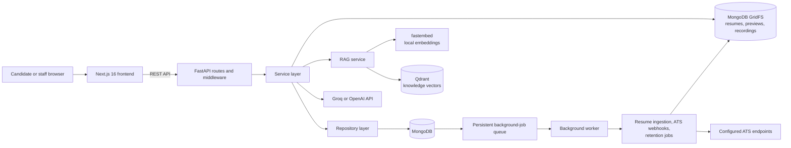

# AI Interview Coach

An AI interview platform with two connected products:

- **Practice:** a candidate uploads a resume and job description, runs a structured mock interview, and gets deferred scoring plus a preparation plan.
- **Recruiting and screening:** a recruiter creates a requisition and interview template, invites candidates through magic links, reviews scorecards, integrity signals, recordings, and analytics, and records a human decision.

The AI is advisory. It generates questions, evaluates answers, and surfaces signals; it never makes the hiring decision.

> **Status:** practice, recruiting, screening, review, and compliance surfaces are implemented end to end. The backend suite currently collects **389 tests**, including role/ownership access control, screening, recordings, retention, webhooks, quotas, and usage accounting.
>
> **Data layer:** MongoDB (Motor). Indexes are created on startup; there are no migration files. Recordings use GridFS. Qdrant is used for RAG question generation.

## Quickstart

Prerequisites: Docker Desktop (or Docker Engine) with the Compose plugin, and an
API key for Groq or OpenAI.

Copy the environment templates:

```powershell
# Windows PowerShell
Copy-Item .env.example .env
Copy-Item backend/.env.example backend/.env
```

```bash
# macOS / Linux
cp .env.example .env
cp backend/.env.example backend/.env
```

Set `GROQ_API_KEY` (or `OPENAI_API_KEY`) in the root `.env` for Docker Compose.
Set `BOOTSTRAP_ADMIN_EMAIL`, `BOOTSTRAP_ADMIN_PASSWORD`, and
`BOOTSTRAP_ADMIN_NAME` in `backend/.env` if you want to sign in to the
recruiting and screening workspace on first launch.

```bash
docker compose up --build
```

Before deploying beyond local development, set a strong, unique `JWT_SECRET`
and configure `CORS_ORIGINS` and `FRONTEND_URL` for the real application
origins. Never commit populated `.env` files.

| Service   | Port | Purpose |
|-----------|------|---------|
| `frontend`| 3000 | Next.js app (production build) |
| `backend` | 8000 | FastAPI API (`/api`, interactive docs at `/api/docs`) |
| `mongo`   | 27017 | MongoDB 7 (healthcheck) |
| `qdrant`  | 6333 | Qdrant vector store for RAG (set `RAG_ENABLED=false` to skip) |

Open `http://localhost:3000`. The frontend calls the API at `http://localhost:8000/api` (baked in at build time via `NEXT_PUBLIC_API_URL`).

To stop the services without removing their data volumes:

```bash
docker compose down
```

### First admin (required for recruiting and screening)

Public registration creates **candidate** accounts only. Recruiting and screening
require a staff account, and staff accounts are provisioned by an admin. On a
fresh database, set a seed admin in `backend/.env` before the first start:

```dotenv
BOOTSTRAP_ADMIN_EMAIL=admin@example.com
BOOTSTRAP_ADMIN_PASSWORD=replace-with-a-strong-password
BOOTSTRAP_ADMIN_NAME=Admin
```

Start the stack, log in, and invite recruiters/reviewers from **Team**. Once the
real admin accounts exist, blank the bootstrap password so the seed is not
recreated or promoted on later starts.

### Environment precedence

- **Root `.env`** is read by Docker Compose for interpolation and for the
  variables Compose explicitly passes into the backend.
- **`backend/.env`** is read directly by FastAPI. Put bootstrap admin settings,
  mail settings, feature switches, and any backend-only settings there.
- **`frontend/.env.local`** is read by Next.js. Only `NEXT_PUBLIC_API_URL` is
  required.

`FRONTEND_URL` must match the origin users actually open
(`http://localhost:3000` locally). It is used to build candidate magic links and
staff invitation links.

## Architecture



MongoDB stores application records and the durable job queue. Large resume
files, extracted content, previews, and interview recordings use GridFS. The
worker polls queued jobs; resume OCR/previews use Tesseract and LibreOffice in
the Docker image. RAG embeds the committed knowledge base locally with
fastembed, then retrieves relevant chunks from Qdrant for question generation.

Design rules:

- Routes validate input/output and delegate; services own business logic.
- Repositories own every MongoDB query and map `_id` to `id`.
- LLM and RAG access stay behind `llm_service` / `rag_service`.
- Pydantic v2 schemas define every request and response.
- Errors use a uniform `{"detail": ..., "code": ...}` envelope.

## Product flows

### Practice

1. A candidate registers and uploads a PDF/DOCX resume.
2. They save a job description and create a practice interview.
3. They consent, pass the camera/screen check, and the first question is generated.
4. Each answer is stored during the session; evaluation is deferred until completion.
5. The next question is generated without scoring the previous answer.
6. Finishing normally or ending early evaluates all answers and produces scores, topic feedback, and a preparation plan.

### Recruiting and screening

1. An admin invites staff; the invitee sets a name/password and receives a role.
2. A recruiter creates a requisition and an optional interview template.
3. The recruiter assigns reviewers and creates a candidate invitation.
4. The invitation returns a magic link (`/interview/{token}`); the candidate
   opens it without an account.
5. If proctoring is enabled, the candidate consents and completes a device check.
6. Starting the interview creates a server-side deadline and a guest interview.
7. Answers, recording chunks, and advisory integrity events are stored as they arrive.
8. On completion, the scorecard is built from stored evaluations.
9. Recruiters/reviewers see the pipeline, shortlist, analytics, shadow-mode
   comparison, scorecard, integrity summary, and recording timeline.
10. A human records the decision. If the requisition has a webhook configured,
    an outbound `candidate.decided` event is queued for delivery.

Screening candidates are guests: they do not get `User` rows. The token is the
credential and can be resumed until the invitation expires or the interview is
completed. Treat the link as sensitive.

## Features

### Candidate

- Registration/login, JWT session, profile update
- Resume upload/list/detail/delete with magic-byte/size validation and SHA-256 dedupe
- Original files, full extracted text, page previews, OCR for scans, and structured extraction for every resume section
- Durable resume analysis status (`pending`, `processing`, `ready`, `partial`, `failed`) with retry, download, and preview APIs
- Job-description create/list/detail/delete
- Practice interview lifecycle, structured questions, deferred answer evaluation, final report
- Dashboard stats and interview history

### Recruiting and screening

- Jobs/requisitions with owner, admin, and assigned-reviewer access
- Interview templates with rounds, response modes, proctoring mode, rubric, and threshold
- Staff invitations, role changes, reviewer assignment
- Candidate invitations with reminders, expiry extension, revocation, and audit trail
- Token-based guest screening with consent, round deadline, and resume support
- Camera/screen recording chunks in GridFS and review timeline
- Advisory integrity signals (camera off, tab blur, paste, and related events)
- Scorecards, shortlist ranking, funnel analytics, and human decisions
- Shadow mode: how often the advisory AI would have matched recorded decisions
- CSV and PDF exports, candidate data export, erasure, and configured retention
- ATS webhooks for Greenhouse, Lever, and generic payloads

### Platform and operations

- Per-process rate limiting with `Retry-After` and `X-RateLimit-*` headers
- Structured logging with `X-Request-ID`
- CORS allow-list and security headers
- Usage and cost tracking, monthly LLM budget cap, per-role daily quotas
- Staff seat cap
- API keys for the owner-scoped public API
- Audit log, compliance record, secure webhook secret storage
- Mongo-backed background queue for webhooks, resume ingestion, and retention jobs
- GridFS-backed resume originals, extracted content, and page previews
- Developer checks: backend linting and tests; frontend typecheck and build

## Tech stack

| Layer     | Technology |
|-----------|------------|
| Backend   | Python 3.12+, FastAPI, Pydantic v2, Uvicorn |
| Database  | MongoDB (Motor), GridFS |
| Auth      | JWT (PyJWT), Argon2 password hashing |
| AI        | OpenAI-compatible client (`openai` or `groq`), structured output generation |
| RAG       | Qdrant + fastembed (`BAAI/bge-small-en-v1.5`) |
| Frontend  | Next.js 16, React 19, TypeScript, Tailwind CSS v4, Lucide |
| Infra     | Docker, Docker Compose |

## Folder structure

```text
ai-interview-coach/
├── backend/
│   ├── app/
│   │   ├── api/             # routes and dependency wiring
│   │   ├── core/            # config, database, jobs, webhooks, mail, logging
│   │   ├── models/          # domain models
│   │   ├── schemas/         # request/response schemas
│   │   ├── services/        # business logic and orchestration
│   │   ├── repositories/    # MongoDB queries
│   │   ├── prompts/         # LLM prompts
│   │   └── main.py          # app lifecycle, middleware, routers
│   ├── scripts/             # knowledge-base ingestion and utilities
│   ├── tests/               # backend test suite
│   └── Dockerfile
├── frontend/
│   ├── app/                 # App Router pages
│   ├── components/          # UI, recruiting, interview components
│   ├── hooks/               # auth, media, recorder, integrity, async state
│   ├── services/            # typed API clients
│   ├── lib/                 # API client, formatting, role labels
│   └── Dockerfile
├── docs/features/           # screening and access-control documentation
├── data/knowledge_base/     # RAG source documents
├── docker-compose.yml
└── README.md
```

## Environment variables

Copy `.env.example` to `.env` and `backend/.env.example` to `backend/.env`.
The examples contain the full annotated list; the most important settings are:

| Variable | Description | Default |
|---|---|---|
| `FRONTEND_URL` | Public SPA origin used in magic/invite links | `http://localhost:3000` |
| `CORS_ORIGINS` | Allowed browser origins (comma-separated or JSON) | localhost:3000/5173 |
| `MONGO_URI` / `MONGO_DB_NAME` | MongoDB connection and database | local Mongo / `ai_interview_coach` |
| `JWT_SECRET` | JWT signing secret; required in production | dev-only value |
| `BOOTSTRAP_ADMIN_*` | Optional seed admin created on startup | unset |
| `FEATURE_SCREENING_ENABLED` | Close public registration for staff-invite deployments | `false` |
| `LLM_PROVIDER` | `groq` or `openai` | `groq` |
| `GROQ_API_KEY` / `OPENAI_API_KEY` | Provider credentials | unset |
| `RAG_ENABLED` / `QDRANT_URL` | Toggle and locate the vector store | `true` / local Qdrant |
| `TRANSCRIPTION_PROVIDER` | `none`, `openai`, or `groq` | `none` |
| `MAIL_PROVIDER` | Currently only `console` | `console` |
| `JOBS_ENABLED` | Run the background worker in this process | `false` (Compose: `true`) |
| `RESUME_PROCESSING_INLINE` | Analyze uploads on the request instead of the job worker | `true` (Compose: `false`) |
| `RESUME_OCR_ENABLED` / `RESUME_OCR_LANGUAGES` | Read scanned pages with Tesseract | `true` / `eng` |
| `RESUME_PREVIEW_DPI` / `RESUME_MAX_PREVIEWS` | Page-preview quality and cap | `144` / `40` |
| `TESSERACT_CMD` / `LIBREOFFICE_CMD` | Binary names/paths for OCR and DOCX previews | `tesseract` / `soffice` |
| `INVITATION_TTL_DAYS` | Default candidate link lifetime | `7` |
| `MAX_STAFF_SEATS` | Provisioned staff cap, `0` = unlimited | `0` |
| `MONTHLY_LLM_BUDGET_USD` | AI spend cap, `0` = unlimited | `0` |
| `DATA_RETENTION_DAYS` | Candidate session retention window | `365` |
| `RETENTION_PURGE_ENABLED` | Allow the admin purge endpoint | `false` |
| `FIELD_ENCRYPTION_KEY` | Encrypt webhook secrets at rest | unset (development only) |
| `NEXT_PUBLIC_API_URL` | Backend URL baked into the frontend build | `http://localhost:8000/api` |

Production startup fails if `JWT_SECRET` is still the default or if
`CORS_ORIGINS` contains `*`.

## Local installation (without Docker)

Prerequisites: Python 3.12+, Node.js 20+, MongoDB, and an LLM key. Qdrant is
optional when `RAG_ENABLED=false`.

```bash
cd backend
python -m venv venv
# Windows PowerShell: .\venv\Scripts\Activate.ps1
# macOS/Linux: source venv/bin/activate
pip install -r requirements-dev.txt
# Copy backend/.env.example to backend/.env:
# Windows PowerShell: Copy-Item .env.example .env
# macOS/Linux: cp .env.example .env
# Configure MONGO_URI, FRONTEND_URL, JWT_SECRET, an LLM key, and optional
# BOOTSTRAP_ADMIN_* values in backend/.env.
uvicorn app.main:app --reload
```

```bash
cd frontend
npm install
# Copy frontend/.env.example to frontend/.env.local:
# Windows PowerShell: Copy-Item .env.example .env.local
# macOS/Linux: cp .env.example .env.local
npm run dev
```

- API: `http://localhost:8000/api`
- Health: `GET /api/health`
- Docs: `http://localhost:8000/api/docs` (disabled in production)
- Resume OCR/previews: install Tesseract and LibreOffice, or accept the
  text-only fallback. On Windows, set `TESSERACT_CMD`/`LIBREOFFICE_CMD` if the
  binaries are not on `PATH`.

### Migrating legacy resume files

Older deployments stored uploads under `backend/data/resumes` and kept only a
`storage_key` in MongoDB. Move them into GridFS before removing that volume:

```bash
cd backend
python -m scripts.migrate_resume_storage
# Re-run OCR/preview/structured extraction as part of the migration:
python -m scripts.migrate_resume_storage --analyze
# Delete each local file after its GridFS copy is written:
python -m scripts.migrate_resume_storage --analyze --delete-local
```

The script is idempotent and skips documents that already have an
`original_file_id`. Duplicate content is reported and left untouched.

## API surface

The interactive OpenAPI reference is the source of truth while the backend runs.
The main groups are:

| Area | Endpoints |
|---|---|
| Auth | `POST /api/auth/register`, `POST /api/auth/login`, `GET/PATCH /api/auth/me` |
| Practice | `/api/resumes`, `/api/resumes/{id}/text`, `/api/resumes/{id}/file`, `/api/resumes/{id}/preview/{page}`, `/api/resumes/{id}/analyze`, `/api/job-descriptions`, `/api/interviews`, `POST /api/interviews/{id}/complete`, `POST /api/interviews/{id}/transcribe`, `/api/questions/{id}/answer`, `/api/dashboard/stats` |
| Jobs | `GET/POST /api/jobs`, `GET/PATCH/DELETE /api/jobs/{id}`, `PUT /api/jobs/{id}/reviewers` |
| Templates | `GET/POST /api/templates`, `GET/PATCH/DELETE /api/templates/{id}`, `POST /api/templates/{id}/preview` |
| Staff | `/api/staff/invitations`, `POST /api/staff/invitations/accept`, `/api/staff/users`, `PATCH /api/staff/users/{id}/role`, `GET /api/staff/reviewers` |
| Recruiter screening | `/api/invitations` (create/list), `/{id}/remind`, `/{id}/extend`, `/{id}/decision`, `/{id}/scorecard`, `/{id}/integrity`, `/{id}/timeline`, `/{id}/data`, `/{id}/erase`, `/shortlist`, `/analytics`, `/shadow`, `/export`, `/export.pdf`, `/retention/purge` |
| Candidate screening | `GET /api/screening/{token}`, `POST /{token}/start`, `GET /{token}/current-question`, `POST /{token}/questions/{id}/answer`, `POST /{token}/recordings/chunk`, `POST /{token}/proctoring/events`, `POST /{token}/transcribe` |
| Platform | `/api/api-keys`, `/api/public/jobs`, `/api/public/jobs/{id}/candidates`, `/api/public/jobs/{id}/metrics`, `/api/usage/summary`, `/api/usage/quotas`, `/api/compliance`, `/api/audit-logs` |
| Health | `GET /api/health` |

## Operating model and limitations

- **Email is not delivered by default.** Only the `console` mail provider ships.
  Invitations are returned to the recruiter in the API response and shown in the
  UI; copy the link and send it manually. Adding SMTP/SES requires implementing
  the `Mailer` interface.
- **Webhooks and resume ingestion need a worker.** Both use the MongoDB-backed
  queue. Docker Compose enables it (`JOBS_ENABLED=true`) and sets
  `RESUME_PROCESSING_INLINE=false`. For a non-Docker run, either enable the
  worker in `backend/.env` or keep `RESUME_PROCESSING_INLINE=true`. With no
  worker and inline processing disabled, uploads stay `pending` and webhooks
  stay queued.
- **OCR and DOCX previews need CLI tools.** Scanned PDFs use Tesseract; DOCX
  previews use LibreOffice. The Docker image installs both. Without them the
  original, text, and structured analysis still work, and the resume records a
  warning instead of failing.
- **Resume storage is durable and owner-scoped.** Originals, extracted content,
  and previews live in GridFS and are served only through authenticated routes.
  Deleting a resume also deletes any unfinished interviews that reference it,
  including their answers and stored recordings. AI failure keeps the upload and
  text; use retry analysis instead of re-uploading.
- **Retention is manual.** `POST /api/invitations/retention/purge` erases expired
  session data and anonymizes invitation rows, but no scheduler enqueues it
  automatically. Run it from an admin/cron process if automatic retention is required.
- **Rate limiting is in-process.** It is accurate for one backend process. Use
  Redis before scaling to multiple replicas.
- **`FEATURE_SCREENING_ENABLED` only closes public registration.** It is not a
  router-level feature gate.
- **Ownership is single-tenant per user.** Recruiters own their requisitions;
  admins can cross owner boundaries; reviewers are limited to assigned jobs.
- **Recordings are sensitive.** They live in GridFS and are access-checked through
  the invitation/requisition, but anyone holding a live candidate token can
  continue the interview session.

## Testing

```bash
cd backend
# Windows
.\venv\Scripts\python -m pytest -q
# Linux / macOS
.venv/bin/python -m pytest -q
```

- The suite boots an ephemeral MongoDB and uses a dedicated test database.
- LLM calls are mocked; Qdrant runs in memory.
- Run `ruff check app tests scripts` for linting. `ruff format app tests
  scripts` is available locally; formatting is not enforced automatically.

Coverage includes auth, config, uploads, practice interviews, jobs/templates,
staff roles, owner/admin/reviewer access, invitations, screening, recordings,
integrity, scorecards, shortlist, analytics, shadow mode, exports, retention,
erasure, audit logs, quotas, usage, API keys, webhooks, CORS, rate limits, error
envelopes, and logging.

## Frontend checks

```bash
cd frontend
npm run typecheck
npm run build
```

There is no frontend test runner or ESLint/Prettier configuration yet; the
available checks are TypeScript typechecking and a production build.

## Security notes

- Passwords are Argon2-hashed; JWTs are signed with `JWT_SECRET`.
- Protected routes are validated per request; roles and ownership are enforced
  server-side, and cross-owner admin mutations are audited.
- Candidate magic-link and staff-invite tokens are stored as SHA-256 hashes.
  Raw tokens exist only in the link.
- Resume uploads are validated by extension, magic bytes, and size, deduplicated
  by SHA-256 per user, and stored in owner-scoped GridFS collections. Original
  downloads and previews require the owner's Bearer token; no storage path or
  GridFS id is exposed by the API.
- Contact email/phone values are redacted before resume text is sent to the
  configured LLM; deterministic contact fields are extracted locally.
- Request bodies above `MAX_BODY_BYTES` are rejected before being read.
- CORS is an explicit allow-list with credentials disabled; the SPA uses a
  Bearer token.
- Webhook signing secrets can be encrypted at rest with `FIELD_ENCRYPTION_KEY`.
  Without it, they are stored in plaintext and should be treated as
  development-only.
- `/api/docs` is disabled in production.
- `.env` files are gitignored; only examples are committed.

## Further documentation

- [Screening flow](docs/features/screening-flow.md)
- [Job and candidate access control](docs/features/job-access-control.md)
